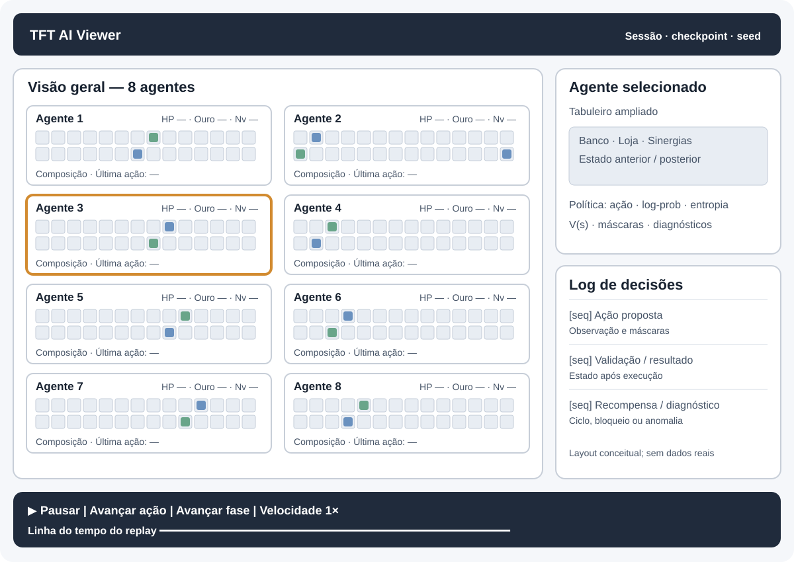

# Planejamento do visualizador TFT — 8 agentes PPO

> **Status:** planejamento e auditoria inicial; ainda sem implementação do visualizador.  
> **Repositório:** victoremilianosilva/teste-ia  
> **Pasta de documentação visual:** viwer/ (nome mantido exatamente como solicitado).  
> **Última revisão:** 2026-10-15.

Este documento é a fonte de referência do projeto de visualização. Toda decisão futura sobre arquitetura, eventos, logs, replay, inferência ou interface deve ser refletida aqui para evitar que o plano fique espalhado em conversas.

## 1. Objetivo

Construir um visualizador desktop para observar um lobby real do projeto TFT-like, com **oito agentes PPO jogando a mesma partida**, incluindo:

- Visão geral dos oito jogadores, com tabuleiros e indicadores.
- Ampliação de qualquer jogador sem perder o contexto do lobby.
- Execução ao vivo, pausa, avanço controlado e velocidade de apresentação.
- Reprodução de partidas gravadas, com navegação na linha do tempo.
- Log detalhado das decisões de cada agente.
- Debug de probabilidades, valor estimado, máscaras, ações inválidas, loops e diagnósticos.
- Comparação de sessões e checkpoints treinados por quantidades diferentes de atualizações.

**Princípio central:** treinar e visualizar são atividades separadas. Primeiro treinamos por X atualizações e salvamos o checkpoint; depois carregamos esse checkpoint para executar uma avaliação sem atualizar os pesos.

## 2. Fluxo de trabalho

1. Treinar o PPO por uma quantidade escolhida de atualizações.
2. Salvar e identificar o checkpoint resultante.
3. Abrir o visualizador e selecionar o checkpoint.
4. Configurar inferência, seed e parâmetros da sessão.
5. Executar um lobby com oito jogadores controlados pela política selecionada.
6. Observar os jogadores, inspecionar decisões e gravar a sessão.
7. Reabrir o replay e investigar decisões específicas.
8. Comparar sessões de checkpoints diferentes sob condições controladas.

Podemos, por exemplo, avaliar checkpoints após 10, 50 ou 200 atualizações. Esses números são exemplos, não parâmetros fixos.

## 3. Arquitetura proposta

A arquitetura tem cinco responsabilidades:

1. **Política PPO (Python/PyTorch):** carrega o checkpoint e calcula ações.
2. **Controlador de avaliação:** coordena ritmo, seed, pausa, avanço e sequência de ações.
3. **Engine C++ existente:** continua sendo a autoridade sobre regras, economia, loja, unidades, combate, recompensas e resultado.
4. **Camada de eventos/replay:** converte decisões e resultados em registros versionados e persistíveis.
5. **Interface:** apresenta lobby, logs, detalhes e replays sem interferir na lógica do jogo.

A interface não deve acessar estruturas internas da engine diretamente. Uma camada adaptadora estável reduz o acoplamento e permite mudar a tecnologia de interface sem reescrever as regras.

### 3.1 Regras de arquitetura

- A engine C++ continua sendo a fonte da verdade sobre estado e execução.
- A política permanece em Python/PyTorch.
- A interface é observadora; comandos de pausa e avanço são enviados ao controlador.
- Não duplicar regras do jogo no frontend.
- Não alterar observações, máscaras ou recompensas consumidas pelo PPO para acomodar a interface.
- Consumir snapshots e eventos públicos por uma API explícita.
- Registrar versão da engine, checkpoint e configuração da sessão.
- A velocidade de animação não pode mudar a lógica nem a recompensa da partida.

## 4. Carregamento do modelo e inferência

### 4.1 O modelo já treinado é suficiente?

Sim, para avaliação, desde que o checkpoint seja compatível com a arquitetura da política, o ambiente e as dimensões atuais das observações e ações. O fluxo não deve executar otimização PPO nem atualizar pesos.

A sessão precisa:

- Carregar o checkpoint selecionado.
- Instanciar a arquitetura de política compatível.
- Usar modo de avaliação/inferência e evitar gradientes desnecessários.
- Preservar o contrato de observações e máscaras.
- Registrar identificador ou hash do checkpoint e versão da política.
- Registrar seed e configuração da sessão.

### 4.2 Modos selecionáveis

A interface deve oferecer os dois modos:

- **Determinístico:** seleciona a ação preferida pela política segundo a implementação existente. Útil para avaliações mais repetíveis.
- **Estocástico:** amostra a ação segundo a distribuição da política. Útil para observar a variabilidade do comportamento.

Mesmo com modo determinístico, não se deve prometer resultados idênticos se mudarem seed, estado inicial, engine, ordem de execução ou configuração. No modo estocástico, registrar seed e configuração de amostragem é especialmente importante.

### 4.3 Uma política ou oito?

A configuração inicial recomendada é **uma política/checkpoint compartilhada pelos oito agentes**, mantendo estado de jogo e histórico independentes para cada jogador. Não é necessário carregar oito cópias dos mesmos pesos se a API atual permitir compartilhar o modelo com segurança.

A arquitetura deve permitir futuramente carregar políticas ou checkpoints diferentes por assento para comparação. Isso não é requisito da primeira versão.

## 5. Interface: visão geral e foco individual

A tela principal deve mostrar os oito jogadores ao mesmo tempo. **Cada cartão de jogador contém o tabuleiro completo daquele jogador, em uma grade de 7 colunas × 4 linhas (28 posições), com cada peça desenhada na posição ocupada correta.** Não basta mostrar uma composição resumida ou apenas as unidades da primeira fileira.

Cada cartão deve incluir, quando os dados estiverem disponíveis:

- Identificador do jogador e estado no lobby.
- Tabuleiro 7×4 completo, com as posições livres e ocupadas visíveis.
- Identificação compacta de cada peça; estrelas/nível de estrela quando disponível.
- Indicadores resumidos de vida, ouro, nível e XP.
- Fase/rodada e última ação relevante.
- Realce do jogador selecionado e de mudanças recentes no tabuleiro.

Ao selecionar um jogador, o painel de inspeção mostra o seu tabuleiro em tamanho ampliado, com coordenadas das casas e informações da peça selecionada, além de banco, loja, sinergias e logs. As coordenadas devem seguir o mesmo padrão usado pela engine, sem criar uma segunda convenção que confunda a depuração.

### 5.1 Controles de espectador

- Iniciar/retomar e pausar.
- Avançar uma decisão/etapa, quando compatível com a granularidade real do controlador.
- Avançar uma fase ou rodada.
- Ajustar a velocidade visual.
- Selecionar um dos oito agentes.
- Filtrar eventos por agente, tipo, rodada ou gravidade.
- Alternar entre sessão ao vivo e replay.
- Entrar e sair da visualização detalhada de combate sem perder o contexto da partida.

A granularidade de avanço deve ser definida após auditar a API da engine. Não assumir que é possível avançar exatamente uma ação se a engine só aceitar lotes de ações do lobby.

### 5.2 Combate detalhado ao clicar em um jogador

Durante a fase de combate, clicar no cartão de um jogador abre uma **visão de batalha dedicada** para o confronto dele. Essa tela deve mostrar todas as peças participantes dos dois lados — as unidades do jogador selecionado e todas as unidades inimigas —, e não apenas o campeão selecionado ou um resumo do combate.

A visão de combate deve incluir:

- Campo de batalha com as peças dos dois times e sua posição atual, diferenciadas visualmente por equipe.
- Nome/identificador de cada unidade e, quando disponível, estrelas, vida atual/máxima, barra de HP, mana e estado (viva, eliminada, alvo/atacando).
- Atualização temporal da posição e dos atributos durante o combate, conforme os eventos ou snapshots realmente emitidos pela engine.
- Linha do tempo de combate com eventos como movimento, ataque, habilidade, dano, eliminação e fim de combate, apenas quando esses dados forem fornecidos.
- Controles de pausa, velocidade, avanço de evento e retorno à visão geral.
- Seleção de uma unidade para inspecionar seus dados sem esconder as demais peças.
- Resultado final e resumo do confronto após a engine concluir a batalha.

**Limite técnico a validar:** a animação fiel só é possível se a engine expuser estados intermediários ou eventos de combate com timestamp/ordem, posições e atributos por unidade. Se hoje a engine apenas calcula o resultado final (por exemplo, uma comparação agregada de poder), a primeira versão deve exibir o que realmente existe e marcar a animação detalhada como indisponível; não inventar trajetórias, HP, dano ou habilidades. Nesse caso, uma evolução da engine será necessária para emitir snapshots/eventos intermediários, sem alterar silenciosamente a semântica de treinamento.

## 6. Logs de decisão: requisito central

O visualizador precisa responder, para cada jogador: **o que recebeu, o que escolheu, quais alternativas eram permitidas, o que a engine executou, qual foi o resultado e quais diagnósticos surgiram?**

### 6.1 Categorias de eventos propostas

- match_started / match_finished
- phase_changed / round_started / round_finished
- decision_started
- policy_output
- action_proposed
- action_validated / action_rejected
- action_executed / action_failed
- state_changed
- combat_started / combat_finished
- reward_emitted
- player_eliminated
- anti_loop_detected / anti_loop_blocked
- strategy_changed
- diagnostic_warning / diagnostic_error

Esses nomes são propostas para um esquema de eventos tipado; não significam que todas essas categorias já sejam emitidas pela engine.

### 6.2 Campos mínimos de cada evento

| Campo | Significado |
|---|---|
| schema_version | Versão do esquema de eventos. |
| match_id | Identificador único da sessão/partida. |
| sequence_id | Ordem monotônica global do evento. |
| decision_id | Agrupa registros pertencentes à mesma decisão. |
| round, stage, phase | Contexto do jogo, quando aplicável. |
| player_id | Identificador do assento/jogador de 1 a 8. |
| checkpoint_id | Identidade do modelo utilizado. |
| event_type | Tipo de evento. |
| timestamp | Tempo de parede para diagnóstico; a ordem oficial é sequence_id. |
| observation_ref | Referência à observação exata usada na inferência. |
| action_proposed | Componentes da ação selecionada. |
| action_validation | Estado da validação e motivo explícito. |
| action_result | Resultado real confirmado pela engine, quando existir. |
| policy_diagnostics | Log-probabilidade, entropia, valor estimado e distribuições expostas. |
| reward_components | Recompensas relevantes, mantendo a semântica atual. |
| state_before_ref, state_after_ref | Referências a snapshots antes/depois. |
| diagnostics | Ciclos, bloqueios, anomalias e explicações derivadas. |

Os eventos devem ser estruturados, não apenas strings livres. Mensagens humanas podem ser adicionadas para legibilidade, mas não substituem campos tipados.

### 6.3 Ação proposta não é ação executada

O log deve distinguir rigorosamente:

1. Ação escolhida pela política.
2. Ação validada ou rejeitada.
3. Ação enviada à engine.
4. Resultado real após a execução.
5. Mudança observada no estado.

Se uma validação rejeitar um lote, não registrar a ação como executada. Se a engine não fornecer confirmação granular por jogador, essa limitação deve ser registrada e corrigida na integração, não escondida na interface.

## 7. Debug da política PPO

A política atual usa uma ação estruturada em seis componentes: tipo, slot da loja, slot do banco, alvo do tabuleiro, origem do tabuleiro e alvo condicionado do movimento. A ordem exata e a semântica devem ser confirmadas no código da política antes de implementar o logger.

### 7.1 Dados a registrar

- Ação final selecionada.
- Log-probabilidade total, se fornecida pela política.
- Entropia, se fornecida.
- Valor estimado V(s).
- Distribuição/probabilidades disponíveis em cada cabeça relevante.
- Alternativas de maior probabilidade.
- Máscara aplicada em cada etapa.
- Dependências condicionais entre componentes da ação.
- Modo determinístico/estocástico e seed de sessão.

### 7.2 Probabilidades condicionais

As probabilidades dos componentes não devem ser apresentadas como seis escolhas independentes quando uma etapa depende da anterior. Por exemplo, a distribuição do destino de um movimento pode depender da origem escolhida e da máscara correspondente.

O painel deve mostrar probabilidades condicionadas à decisão anterior e à máscara aplicada. A probabilidade de uma ação completa, se apresentada, deve ser calculada corretamente segundo a distribuição autorregressiva implementada.

### 7.3 Fato, diagnóstico e interpretação

O visualizador deve separar três níveis:

- **Fato:** o movimento ocorreu da posição A para B.
- **Diagnóstico derivado:** o movimento não alterou o estado ou repetiu uma assinatura anterior.
- **Interpretação:** hipótese de que o agente tentava proteger um carregador, caso existam evidências suficientes.

Não atribuir ao modelo uma justificativa em linguagem natural que ele não produziu. Diagnósticos derivados precisam indicar a regra que os originou.

## 8. Máscaras, ações inválidas e anti-loop

A auditoria inicial identificou infraestrutura nativa para snapshot de auditoria e métricas anti-loop, mas a trilha individual de tentativa/causa/resultado precisa ser completada.

Para cada ação inválida ou bloqueada, registrar:

- Jogador e decisão.
- Componentes da ação.
- Máscara vigente e regra de validação aplicada.
- Motivo explícito da rejeição.
- Se a rejeição ocorreu antes do lote ou durante a execução.
- Estado anterior e confirmação de que não houve alteração indevida.
- Contador/métrica anti-loop relacionada, quando aplicável.

Para movimentos repetitivos, registrar assinatura do estado relevante, origem/destino, ação anterior equivalente, número de repetições e regra que detectou o ciclo. Evitar armazenar apenas um contador agregado: ele não basta para investigar um caso individual.

A instrumentação não deve mudar silenciosamente a política nem substituir a máscara usada no treinamento. Qualquer bloqueio operacional deve estar explícito, auditável e consistente com as regras atuais.

## 9. Snapshots e contrato de integração

Estruturas conceituais propostas:

- **LobbySnapshot:** estado público de todos os oito jogadores em um instante.
- **PlayerSnapshot:** economia, nível, XP, banco, loja, tabuleiro, vida e estado do jogador.
- **DecisionRecord:** observação, máscaras, saída da política e ação proposta.
- **ActionExecutionRecord:** validação, execução e resultado confirmado.
- **GameEvent:** combate, rodada, eliminação, recompensa e mudança de fase.
- **DiagnosticEvent:** ação inválida, loop, bloqueio e anomalia.
- **MatchMetadata:** checkpoint, seed, versão da engine, configuração e modo de inferência.
- **ReplayIndex:** índice de snapshots e sequência de eventos para navegação.

Esses nomes são conceitos do contrato, não classes já existentes.

### 9.1 APIs existentes a reaproveitar

Na auditoria estática inicial da branch main, foram identificados estes pontos relevantes:

- TFTPolicy em policy.py, com inferência determinística/estocástica e saídas de diagnóstico como log-probabilidade, entropia e valor.
- get_audit_snapshot() na engine C++ e seus bindings nativos.
- get_action_masks() e APIs de estado do lobby.
- cpp_lobby_env.py, adaptador Python para o backend nativo.
- Métricas de anti-loop e recompensas existentes.
- scripts/evaluate_checkpoints.py, referência para carregar checkpoints e executar avaliação.

Links:
- [policy.py](https://github.com/victoremilianosilva/teste-ia/blob/main/policy.py)
- [cpp_lobby_env.py](https://github.com/victoremilianosilva/teste-ia/blob/main/cpp_lobby_env.py)
- [scripts/evaluate_checkpoints.py](https://github.com/victoremilianosilva/teste-ia/blob/main/scripts/evaluate_checkpoints.py)
- [TftEngine.hpp](https://github.com/victoremilianosilva/teste-ia/blob/main/cpp/include/lobby/TftEngine.hpp)
- [Bindings Python](https://github.com/victoremilianosilva/teste-ia/blob/main/cpp/bindings/tft_engine_bindings.cpp)

**Limitação da auditoria:** foi uma inspeção estática dos arquivos de main; a engine não foi executada nesta etapa. Antes da implementação, validar assinaturas completas, formatos de retorno e caminhos de erro na versão local compilada.

## 10. Replay reproduzível

O replay deve reproduzir os dados gravados, não pedir à política que jogue novamente e presumir que a partida será idêntica. Isso é especialmente importante no modo estocástico.

### 10.1 Persistência recomendada

Para a primeira versão, usar arquivos versionados de sessão com:

- Metadados de partida.
- Eventos estruturados em ordem global.
- Snapshots completos em pontos selecionados.
- Referências de decisão e estado anterior/posterior.
- Resultado final e classificação.
- Identidade do checkpoint, seed e versões.

Formato físico (JSONL, SQLite ou outro) ainda deve ser decidido após medir volume, custo de gravação e requisitos de navegação. A interface deve depender do contrato lógico, não do formato físico.

### 10.2 Integridade do replay

- Cada evento deve ter sequência estável.
- Cada referência de snapshot deve resolver para um estado gravado.
- O fim da partida deve incluir a classificação final real.
- A ausência de um campo não deve ser substituída por valores inventados.
- O esquema precisa ser versionado para permitir evolução.
- A gravação deve poder ser desativada ou ter níveis configuráveis para limitar overhead, mantendo debug completo disponível quando solicitado.

## 11. Comparação entre checkpoints

O visualizador deve facilitar avaliações após diferentes quantidades de treinamento. Para que os resultados sejam comparáveis, registrar pelo menos:

- Identificador/hash do checkpoint.
- Número de atualizações de treinamento, quando conhecido.
- Seed da partida.
- Modo de inferência.
- Versão/commit da engine e configuração relevante.
- Assento de cada política, caso existam checkpoints diferentes.
- Colocação, vitória, top 4, duração e métricas escolhidas.
- Quantidade de ações, inválidas, bloqueios e ciclos por agente.

Uma única partida serve para observar comportamento, mas não prova superioridade de um checkpoint. Avaliações comparativas precisam de várias partidas e condições controladas.

## 12. Tecnologia: orientação, ainda não decisão final

Direção inicial:

- Engine: C++ atual.
- Modelo: Python/PyTorch.
- Controlador: Python, aproveitando a integração existente.
- Interface: aplicação desktop com frontend moderno e ponte local com o controlador.
- Persistência: arquivos de replay versionados.

A tecnologia específica de frontend, comunicação e armazenamento deve ser escolhida depois de confirmar as APIs atuais e estimar volume de eventos. Não é necessário reescrever a engine ou migrar a política para C++.

## 13. Plano de implementação

### Fase 1 — Auditoria e contrato
- [ ] Confirmar API real do lobby e do binding C++.
- [ ] Expor o snapshot de auditoria pelo adaptador Python.
- [ ] Confirmar formato e semântica dos seis componentes de ação.
- [ ] Definir esquema versionado de eventos e snapshots.
- [ ] Confirmar como obter classificação final e resultado por jogador.

### Fase 2 — Avaliação com checkpoint
- [ ] Carregar checkpoint treinado sem executar otimização.
- [ ] Selecionar modo determinístico/estocástico.
- [ ] Fixar e registrar seed/configuração.
- [ ] Executar um lobby de oito jogadores pelo controlador atual.
- [ ] Verificar que a visualização não altera pesos nem recompensas.

### Fase 3 — Instrumentação de debug
- [ ] Registrar entrada da política, máscaras e ação proposta.
- [ ] Expor distribuições/probabilidades condicionais.
- [ ] Registrar log-probabilidade, entropia e valor estimado.
- [ ] Registrar validação, resultado real e estados anterior/posterior.
- [ ] Instrumentar ações inválidas e bloqueios anti-loop com causa individual.
- [ ] Testar consistência e ausência de efeitos parciais em ações rejeitadas.

### Fase 4 — Primeira interface
- [ ] Renderizar os oito tabuleiros.
- [ ] Exibir vida, ouro, nível, loja, banco e unidades disponíveis.
- [ ] Selecionar e ampliar qualquer agente.
- [ ] Filtrar o log por agente, rodada, tipo e gravidade.
- [ ] Adicionar controles de pausa, avanço e velocidade.

### Fase 5 — Replay
- [ ] Persistir metadados, eventos e snapshots.
- [ ] Navegar pela linha do tempo.
- [ ] Selecionar uma decisão e inspecionar o estado associado.
- [ ] Reproduzir resultados gravados sem executar novamente a política.
- [ ] Testar sessões com versões distintas do esquema.

### Fase 6 — Análise de comportamento
- [ ] Detectar ciclos de movimentos e ações repetidas.
- [ ] Exibir métricas por agente e por partida.
- [ ] Comparar checkpoints em sessões controladas.
- [ ] Medir overhead de logging e ajustar níveis de detalhe.

## 14. Critérios de aceite

A primeira versão completa será funcional quando:

1. Carregar checkpoint treinado e executar lobby real de oito jogadores sem otimização PPO.
2. Mostrar os oito jogadores com o tabuleiro completo 7×4 e posição de cada peça, e permitir ampliar qualquer um.
3. Durante combate, abrir uma visão dedicada ao clicar no jogador, mostrando todas as unidades dos dois lados e atualizando posições/HP/mana quando a engine fornecer eventos intermediários.
4. Oferecer inferência determinística e estocástica selecionável.
5. Registrar ação proposta, máscara, validação e resultado real sem confundi-los.
6. Expor log-probabilidade, entropia, valor estimado e probabilidades relevantes, respeitando a estrutura condicional da política.
7. Registrar ações inválidas, loops e bloqueios com contexto individual.
8. Gravar e reabrir replay sem depender de executar novamente a política.
9. Preservar regras, observações, máscaras e recompensas da engine.
10. Identificar checkpoint, seed e versões necessárias para interpretar a sessão.
11. Documentar campos indisponíveis e falhas de gravação sem fabricar dados.

## 15. Registro de decisões

Decisões já alinhadas:

- [x] O lobby visualizado terá oito agentes na mesma partida.
- [x] O visualizador terá visão geral e ampliação de qualquer agente.
- [x] Haverá modo ao vivo e replay.
- [x] O modelo será treinado separadamente e depois carregado para avaliação.
- [x] Inferência determinística e estocástica será selecionável.
- [x] O log será de debug completo, incluindo probabilidades da política, valor estimado, ações inválidas, ciclos e diagnósticos.
- [x] O visualizador não deve alterar regras, recompensas nem pesos do PPO.
- [x] A engine C++ continua sendo a fonte da verdade.
- [x] A pasta de diagramas e imagens se chama viwer/, conforme solicitado.
- [ ] A tecnologia exata da interface ainda será decidida.
- [ ] O formato físico de persistência de replay ainda será decidido.
- [ ] O esquema final de eventos será validado contra as assinaturas reais do código.
- [x] A visão geral foi especificada para exibir o tabuleiro 7×4 completo de cada um dos oito jogadores, com posição individual das peças.\n- [x] Durante combate, clicar no jogador abre uma tela separada com todas as unidades dos dois lados e atualização condicionada aos dados reais da engine.\n- [ ] Confirmar se a engine atual emite eventos/snapshots intermediários de combate com posição e HP por unidade.\n- [ ] A implementação ainda não começou.

## 16. Manutenção deste documento

Toda nova decisão acordada para o visualizador deve atualizar este documento na mesma mudança que altera o planejamento ou a implementação. Atualizar, conforme necessário:

1. **Decisões do projeto:** marcar a decisão e sua justificativa.
2. **Arquitetura e contratos:** manter diagramas e nomes dos eventos alinhados com o código real.
3. **Plano de implementação:** marcar tarefas concluídas apenas após validação.
4. **Critérios de aceite:** registrar testes realizados e resultados reais.
5. **Diagramas em viwer/:** atualizar as imagens quando o fluxo, a interface ou a arquitetura mudar.

Não marcar tarefas como concluídas com base apenas em inspeção estática. Distinguir claramente entre planejado, implementado, testado e validado em execução.
