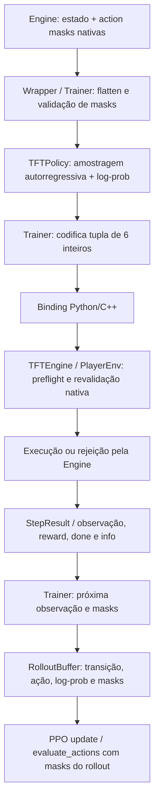

# Action / Mask Contract v1 — auditoria e proposta (draft)

**Status:** proposta documental para Gate 2. Não é contrato aprovado nem autorização de implementação.  
**Base auditada:** branch `new-arquiteture`, commit de base `046c9300882ebb7fb0003436f39d91eb4a2a75e5`.  
**Issue:** [#294 — PPO Action Contract](https://github.com/victoremilianosilva/ia-tft-manager/issues/294)

## 1. Fronteiras que não podem ser confundidas

1. A Policy PPO seleciona uma ação dentro do catálogo PPO e calcula sua log-probabilidade.
2. As action masks expressam as opções permitidas para uma identidade/estado de decisão específico.
3. A Engine valida novamente a ação contra o estado atual e permanece a autoridade final de legalidade.
4. A arquitetura estratégica/Shadow pode produzir recomendações e candidatos, mas não altera o catálogo PPO, não substitui masks e não executa ações.
5. A observação é contexto para decisão; dimensão/ordem do Observation Schema não define dimensão/ordem do Action Contract.

Nenhuma recomendação Shadow pode ser promovida automaticamente a ação executável. A divergência PPO-vs-Shadow é diagnóstico, não prova de erro nem rótulo de treinamento.

## 2. Catálogo e codificação atualmente encontrados

A Policy ativa declara `ACTION_DIMS = [9, 5, 9, 28, 28, 28]`; o enum C++ declara nove tipos, IDs 0–8. O registro da ação é uma tupla de seis inteiros:

`[type, shop_slot, bench_slot, board_target, board_source, board_move_target]`

| ID | Tipo | Argumentos condicionais observados |
|---:|---|---|
| 0 | BUY | `shop_slot` (índice da loja, 0–4) |
| 1 | REROLL | nenhum |
| 2 | BUY_XP | nenhum |
| 3 | MOVE_BENCH | `bench_slot` (0–8), `board_target` (0–27) |
| 4 | MOVE_BOARD | `board_source` (0–27), `board_move_target` (0–27) |
| 5 | SELL | `bench_slot` (0–8) |
| 6 | PASS | nenhum |
| 7 | EQUIP_FROM_INVENTORY | `item_inventory_head` (9 opções) é empacotada em `bench_slot` (0–8); `item_target_head` (37 opções) em `board_target` (0–36) |
| 8 | CRAFT_AND_EQUIP | `item_component_first_head` (10 opções) é empacotada em `shop_slot` (0–9); `item_component_second_head` (10 opções) em `bench_slot` (0–9); `item_target_head` (37 opções) em `board_target` (0–36) |

**Dimensões versus cabeças condicionais:** `ACTION_DIMS = [9, 5, 9, 28, 28, 28]` descreve as seis posições do registro PPO legado e suas cabeças-base; não é o inventário completo de todas as distribuições categóricas internas da Policy. As ações de item usam cabeças dedicadas adicionais com dimensões 9, 10, 10 e 37, e empacotam os índices escolhidos nas posições já existentes do registro de seis inteiros. Assim, por exemplo, o alvo de item pode chegar a 36 e os componentes a 9, embora as posições legadas `board_target` e `shop_slot` tenham dimensões-base 28 e 5. Não validar argumentos de item usando apenas os limites das cabeças-base; a validação deve ser condicionada ao tipo e às cabeças/masks de item correspondentes.

**Atenção à documentação legada:** `docs/decisions-masks-antiloop.md` ainda descreve sete tipos e dimensões `[7,5,9,28,28,28]`. Isso diverge da Policy e do enum C++ atuais. A documentação deve ser corrigida/explicitamente arquivada como histórica antes de servir de fonte normativa.

Os argumentos são condicionais ao tipo; as seis cabeças não representam seis escolhas independentes. Os IDs e dimensões atuais são inventário, não proposta de expansão ou alteração.

## 3. Máscaras atualmente encontradas

| Máscara | Shape ativo esperado | Papel |
|---|---:|---|
| `type_mask` | [9] | tipos PPO disponíveis |
| `shop_mask` | [5] | slots compráveis |
| `bench_source_mask` | [9] | seleção de banco para SELL |
| `bench_move_source_mask` | [9] | origem de MOVE_BENCH |
| `bench_to_board_target_masks` | [9,28] | destino condicionado à origem do banco |
| `board_source_mask` | [28] | origem de MOVE_BOARD |
| `board_move_target_masks` | [28,28] | destino condicionado à origem do tabuleiro |
| `board_target_mask` | [28] | máscara unidimensional agregada/legada de destinos do tabuleiro; não substitui a matriz condicional de MOVE_BENCH |
| `item_inventory_mask` | [9] | item selecionável |
| `item_component_first_mask` | [10] | primeiro componente |
| `item_component_pair_masks` | [10,10] | segundo componente condicionado ao primeiro |
| `item_target_mask` | [37] | alvo de equipamento |

**Contagem e semântica do transporte:** o contrato Python ativo declara exatamente 12 campos em `Trainer.MASK_SHAPES`; a tabela acima enumera os 12. `board_target_mask` é transportada pelo binding, mas não é a autoridade para validar o par origem→destino de `MOVE_BENCH`: esse papel pertence a `bench_move_source_mask` + `bench_to_board_target_masks[source, target]`. Da mesma forma, `MOVE_BOARD` usa `board_source_mask` + `board_move_target_masks[source, target]`. O caminho nativo `refresh_masks` chama `generate_masks(..., include_board_target=false)`; nesse caminho, `board_target_mask` não agrega os destinos reais de banco→tabuleiro e pode conter apenas fallback categórico. Portanto, consumidores não podem inferir legalidade de movimento a partir dessa máscara agregada.

A estrutura C++ também possui `conditioned_board_target_mask`, uma máscara interna agregada para diagnóstico/uso nativo. Ela é distinta de `board_target_mask` e não integra os 12 campos do dicionário de masks entregue ao fluxo PPO pelo binding de `tft_engine_bindings.cpp`.

A implementação C++ separa fallbacks categóricos de disponibilidade real. Um fallback de índice zero em uma cabeça condicional **não** torna BUY/MOVE/SELL legal. `type_mask` continua sendo a máscara da ação principal. Para movimento, destino é condicionado à origem; não se pode validar cada eixo de forma independente.

A geração de masks deve ser pura em relação ao histórico: calcular masks não registra movimentos nem altera AntiLoop. A Engine revalida a ação no momento da execução.

## Evidências de auditoria e rastreabilidade

A revisão cruzou os seguintes pontos da implementação na branch `new-arquiteture`:

- `policy.py`: `ACTION_DIMS`, `get_action_and_value`, `_get_action_and_value_impl`, `get_value` e `evaluate_actions`.
- `trainer.py`: `MASK_SHAPES`, `_flatten_masks`, validação das ações contra as masks e a chamada de geração/consumo de masks.
- `rollout.py`: alocação, persistência e recuperação das máscaras por transição/minibatch.
- `cpp/include/decision/ActionMaskEngine.hpp` e `cpp/src/decision/ActionMaskEngine.cpp`: catálogo de campos nativos, máscaras condicionais, fallbacks e parâmetro `include_board_target`.
- `cpp/src/lobby/TftEngine.cpp`: `populate_strategic_action_masks` e `refresh_masks`; este último usa `generate_masks(..., false)`.
- `cpp/bindings/tft_engine_bindings.cpp`: serialização dos 12 campos públicos de máscara.
- `tests/test_action_mask_validation.py`, `tests/test_policy_bench_target_conditioning.py`, `tests/test_policy_item_conditioning.py` e `tests/test_ppo_mask_consistency.py`: cobertura existente de sampling, condicionais, log-probability e preservação das masks no rollout.

A revisão documental não executou novamente esses testes nem transforma sua existência em evidência de cobertura para cenários ainda não implementados. A matriz da seção 7 separa explicitamente cobertura atual de requisitos futuros.

## 4. Auditoria do fluxo existente

- `TFTPolicy.get_action_and_value(..., masks=None)` continua aceitando ausência de masks. Nesse caminho, a Policy ainda pode amostrar tipos 0–6 sem a fotografia de legalidade; as ações de item 7–8 são desabilitadas. Isso é inadequado para o contrato estrito de execução/inferência e deve ser fechado por API explícita/guardada na implementação pós-Gate 8.
- Com masks presentes, a Policy valida shape, valores binários, finitude, ausência de linhas vazias e ação selecionada contra as masks durante sampling/evaluation.
- `TFTPolicy.get_value(obs, masks=None)` ignora masks atualmente. O contrato futuro deve passar as masks exatas como side input separado ao critic, com correlação de identidade, sem incorporá-las como regras nem duplicá-las no vetor de observação.
- `Trainer._flatten_masks` converte as masks para bool e, se `type_mask` estiver vazia, aplica PASS e fallbacks categoriais. O mesmo fallback é aplicado sem distinguir jogador eliminado de erro/ausência do produtor. Essa ambiguidade precisa ser removida: PASS automático só pode ocorrer quando o estado de eliminação for explícito e validado; mask vazia para jogador ativo ou produtor inconsistente deve falhar fechado.
- `RolloutBuffer` guarda tensores de masks junto da transição, mas não persiste identidade da decisão, versão/hash do contrato nem proveniência da mask. Shape igual não comprova que a mask pertence àquela observação/ação.
- As estruturas C++ `ActionMaskBatch`/`ActionMasks` carregam arrays e disponibilidade/diagnósticos, mas não carregam `decision_identity`, `action_contract_hash`, `mask_contract_hash` ou `mask_snapshot_hash`.
- `DecisionResult` representa masks, validação e erro; não é um envelope estruturado da transição com requested/effective/executed action. Essa distinção precisa ser registrada no retorno de execução/rollout, sem confundir validação com execução.

## 5. Contrato normativo proposto para v1

### 5.1 Identidade e versionamento independentes

Cada decisão deve correlacionar observação, mask, ação amostrada, validação e transição pela mesma identidade:

- `match_id`, `engine_match_id`, `player_id`, `round`, `decision_sequence`, `snapshot_sequence`;
- `decision_identity_hash` calculado de forma determinística sobre os campos de identidade canônicos;
- `action_contract_id/version/hash`;
- `mask_contract_id/version/hash`;
- `mask_snapshot_hash` para o conteúdo exato das masks daquela decisão.

O hash da observação e a identidade da mask devem coincidir. Ausência, mismatch, sequência stale, versão desconhecida, shape/catalog incompatível ou conteúdo inválido bloqueiam sampling, avaliação do critic e replay. Não tentar “consertar” uma mask incompatível com PASS, zeros ou máscara permissiva.

### 5.2 Máscaras exatas como side input

- Actor recebe as masks exatas para aplicar à distribuição categórica em cada cabeça condicional.
- Critic recebe as mesmas masks exatas como side input/contexto separado, além do contexto factual/histórico do Observation Schema.
- Rollout/replay armazenam as masks exatas usadas no sampling, sua identidade/hash e a ação correspondente.
- PPO update recalcula log-probability com as mesmas masks do sampling. Máscara diferente invalida a transição para update/replay.
- A Engine continua revalidando independentemente; máscara não é autorização de execução.

### 5.3 Falha fechada e PASS

- Jogador ativo: PASS também é uma ação legítima e a implementação nativa atual a mantém habilitada junto das demais ações legais. Portanto, a presença de PASS não identifica eliminação nem deve ser usada como fallback para ocultar erro.
- Jogador explicitamente eliminado: PASS é o único tipo real permitido, acompanhado de estado de eliminação explícito e válido.
- Jogador ativo com `type_mask` vazia: erro de contrato/producer; rejeitar a decisão. O fallback atual do Trainer para PASS não é evidência de eliminação e deve ser removido/substituído por tratamento fail-closed na implementação futura.
- Máscaras condicionais: a fatia correspondente a um prefixo/origem selecionado e habilitado deve conter ao menos uma continuação legal. Linhas de origens/primeiros componentes desabilitados podem legitimamente estar vazias; não exigir que toda linha de uma matriz condicional seja não vazia.
- Máscara ausente, stale, hash/identity divergente ou contrato incompatível: rejeitar antes de sampling/critic/replay.
- A execução continua protegida pela validação final da Engine, mesmo que a Policy/Shadow esteja defeituosa.

### 5.4 Fluxo auditado da ação (callgraph)

O fluxo acima descreve a integração atual em alto nível. A implementação ainda não produz, em um envelope único e correlacionado, todos os campos `sampled/requested/effective/executed_action`, status/motivo e hashes de identidade/contrato. Esse é um requisito de evolução, não uma capacidade que este draft afirma já existir. A Engine continua sendo a validação final; uma mask anterior não autoriza execução.

## 5.5 Registro da ação e da transição

Persistir separadamente:
- `sampled_action`: tupla amostrada pela Policy;
- `requested_action`: comando submetido ao executor/Engine;
- `effective_action`: ação normalizada/resolvida, se existir;
- `executed_action`: ação realmente aplicada;
- `validation_status` e motivo/código de rejeição;
- identidade/hash da decisão e versões/hash dos contratos;
- recomendação baseline e recomendação Shadow em campos diagnósticos separados.

Não substituir ação ausente/rejeitada por PASS para fins de comparação PPO-vs-Shadow ou atribuição de reward. PASS só é uma ação efetivamente escolhida/executada quando o contrato e a transição confirmarem isso.

## 6. Invariantes de compatibilidade

1. Observation Schema pode mudar dimensão, ordem, semântica, encoder e projeção sem alterar silenciosamente IDs, dimensões, argumentos ou masks do Action Contract.
2. Alteração do catálogo, IDs, dimensões, codificação de argumentos ou semântica de mask exige nova versão/hash do contrato e aprovação explícita separada.
3. Não inferir compatibilidade por shape, pesos carregáveis ou índice coincidente.
4. Checkpoint manifest (#288) registra separadamente Observation Schema, Action Contract, Mask Contract, catálogo e arquitetura/linhagem.
5. O mesmo contrato/mask identity deve ser verificado em collection, update, evaluation, inference e replay.
6. Shadow candidates permanecem fora do espaço de ações PPO até proposta e aprovação explícitas.

## 7. Matriz de testes exigida antes de fechar o Gate 2

| Grupo | Cenário mínimo | Resultado exigido |
|---|---|---|
| Catálogo | cada ID 0–8, dimensão e argumentos condicionais | mapeamento Python/C++ idêntico |
| Condicionais | cada ação com slot/índice válido e inválido | inválido rejeitado antes da execução |
| Máscaras | cada cabeça e matriz origem→destino | sampling respeita exatamente a máscara |
| Empty masks | jogador ativo com type mask vazia; eliminado com PASS explícito; prefixo/origem selecionado e habilitado sem continuação condicional | ativo falha; eliminado permite somente PASS; prefixo inconsistente falha |
| Missing/stale | mask ausente, snapshot anterior, sequência divergente | fail-closed antes de sampling/critic/replay |
| Hash/version | hash de ação/mask/schema ausente, desconhecido ou incompatível | rejeição explícita |
| PPO consistency | collection vs evaluate/update com a mesma mask | log-probabilities coincidem |
| Replay | transição com máscara/identidade alterada | rejeição, nunca recomputar silenciosamente |
| Critic | mesma observação com masks diferentes; mesma mask com identity diferente | masks afetam contexto do critic; mismatch rejeitado |
| Engine | ação ilegal apesar de máscara permissiva/defeituosa | Engine rejeita |
| Observation independence | variar dimensão/ordem/schema mantendo ação/mask | IDs, dimensões e tradução de ação invariantes |
| Shadow isolation | recomendação divergente ou sem candidato | nenhuma execução/alteração de mask/catálogo |

## 8. Dependências e limites de fase

- #293 fornece `decision_identity_hash`, `mask_reference` e contexto factual/anti-loop, mas não define nem transporta o catálogo/masks.
- #288 persiste os hashes/versões dos contratos no manifest.
- #286 implementará a integração futura da Policy/critic com o schema e side inputs.
- #289 validará correlação em replay multi-round.
- #287 precisa identificar a ação realmente executada para atribuição de reward.
- A auditoria #297 é inventário estático; não substitui testes executáveis.

**Não fazer nesta fase:** mudar `ACTION_DIMS`, IDs, parâmetros, masks, Engine, regras, Policy, critic, rollout, replay, treinamento ou checkpoints. Este draft documenta a fronteira e os gaps; a implementação e seus testes ficam bloqueados até Gate 8 e aprovação explícita.
